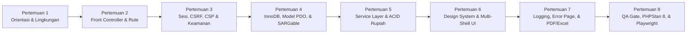

# Rundown Belajar Terstruktur (8 Pertemuan), Bedah Kode, & Modul Praktikum Siswa RPL

Dokumen ini merupakan **kurikulum & peta jalan belajar (*Learning Path*)** resmi bagi siswa SMK Rekayasa Perangkat Lunak (RPL) maupun pengembang baru untuk menguasai arsitektur **Bank Mini (`v1.8.1+`)** secara bertahap dari hari pertama hingga siap mengerjakan fitur produksi.

> [!TIP]
> Setelah memahami rundown 8 pertemuan di bawah ini, lanjutkan langsung ke [**Katalog 12 Tugas Pengembangan Modul & Fitur (`katalog-tugas-pengembangan-fitur-rpl.md`)**](./katalog-tugas-pengembangan-fitur-rpl.md) untuk mulai praktik membangun fitur baru!

---

## 1. Gambaran Alur Belajar (8 Pertemuan / 8 Modul)



---

## 2. Rundown Belajar Detail Per Pertemuan (Rekomendasi Praktikum Sekolah)

Setiap pertemuan dirancang berdurasi **2–4 JP (90–180 menit)** lengkap dengan target kompetensi, daftar file sumber kode yang wajib dibaca berurutan, latihan refleksi (*checkpoint*), dan materi bacaan pendamping.

### Pertemuan 1 — Orientasi Projek, Docker/XAMPP, & Pemahaman Domain Perbankan
- **Tujuan Belajar**: Siswa mampu menjalankan aplikasi lokal (XAMPP atau Docker), mengakses Portal Publik (`/`), halaman login (`/masuk`), Pusat Dokumentasi (`/dokumentasi`), serta memahami aturan bisnis dasar Bank Mini (Rupiah `IDR`).
- **Langkah Praktik (30 Menit Setup + 60 Menit Eksplorasi)**:
  1. Jalankan skrip onboarding `powershell -ExecutionPolicy Bypass -File .\dokumentasi\06-aturan-agen\skrip\siapkan-projek.ps1` (atau `docker compose -f docker-compose.ci.yml up -d`).
  2. Buka `GET /` (Portal Publik), masuk ke `/masuk` menggunakan akun bawaan (`teller1` / `password` atau `admin` / `password`), lalu buka menu **Pusat Dokumentasi** (`/dokumentasi`).
  3. Baca dokumen pengantar: [`00-ikhtisar/README.md`](../00-ikhtisar/README.md), [`panduan-ci-cd-lokal-docker.md`](./panduan-ci-cd-lokal-docker.md), dan [`glosarium-dan-daftar-istilah.md`](./glosarium-dan-daftar-istilah.md).
- **Checkpoint Pemahaman**:
  - Apa perbedaan peran `admin`, `teller`, dan `supervisor` di Bank Mini?
  - Mengapa endpoint `/kesehatan` mengembalikan JSON `status: sehat`?

### Pertemuan 2 — *Front Controller*, PSR-4 Autoloading, & Perutean HTTP (`GET` vs `POST`)
- **Tujuan Belajar**: Siswa memahami mengapa aplikasi modern menolak akses langsung file PHP (seperti `setor.php`) dan menggunakan satu pintu masuk tunggal.
- **File Kode Wajib Dibaca (Urut 1 -> 4)**:
  1. [`public/.htaccess`](../../public/.htaccess) & [`.htaccess`](../../.htaccess) — Pengarah trafik ke `public/`, kompresi Gzip, & pemblokir folder internal.
  2. [`konfigurasi/aplikasi.php`](../../konfigurasi/aplikasi.php) — *Single Source of Truth* konfigurasi (`versi`, `mode_debug`, `zona_waktu`).
  3. [`public/index.php`](../../public/index.php) — *Front Controller* & autoloader namespace `Aplikasi\`.
  4. [`aplikasi/Inti/Perute.php`](../../aplikasi/Inti/Perute.php) & [`aplikasi/Inti/PengendaliDasar.php`](../../aplikasi/Inti/PengendaliDasar.php).
- **Checkpoint Pemahaman**:
  - Mengapa memanggil rute yang tidak terdaftar sekarang memicu HTTP `404` terpusat lewat `PengecualianHttp`?
  - Mengapa aksi penyimpanan data wajib memakai `daftarPost()`, sedangkan tampilan halaman memakai `daftarGet()`?

### Pertemuan 3 — Keamanan Berlapis: Sesi, Idle Timeout, Brute-Force, CSRF, XSS, & CSP
- **Tujuan Belajar**: Siswa menguasai pertahanan aplikasi keuangan terhadap serangan *XSS*, *CSRF*, *Session Fixation*, *Brute-Force*, dan pencurian cookie.
- **File Kode Wajib Dibaca**:
  1. [`aplikasi/Inti/Sesi.php`](../../aplikasi/Inti/Sesi.php) — `HttpOnly`, `SameSite=Lax`, flag `secure`, `regenerasiIdSesi()`, & *Idle Timeout* 30 menit.
  2. [`aplikasi/Inti/TokenCsrf.php`](../../aplikasi/Inti/TokenCsrf.php) — Pembuatan token kriptografis & verifikasi `hash_equals()`.
  3. [`aplikasi/Inti/PembatasLaju.php`](../../aplikasi/Inti/PembatasLaju.php) & [`aplikasi/Layanan/LayananAutentikasi.php`](../../aplikasi/Layanan/LayananAutentikasi.php) — Pembatas laju maks 5 gagal/5 menit & verifikasi BCrypt.
  4. [`aplikasi/Inti/MiddlewareAutentikasi.php`](../../aplikasi/Inti/MiddlewareAutentikasi.php) — Autentikasi vs Otorisasi RBAC (`wajibPeran()` -> HTTP `403`).
  5. [`aplikasi/Pembantu/fungsi_umum.php`](../../aplikasi/Pembantu/fungsi_umum.php) — Fungsi murni `amankanHtml()`.
- **Dokumen Pendamping**: [`standar-kode-dan-keamanan.md`](./standar-kode-dan-keamanan.md) (Bagian 3–4).
- **Checkpoint Pemahaman**:
  - Mengapa atribut `onclick="..."` di HTML dilarang ketika header `Content-Security-Policy: script-src 'self'` aktif?

### Pertemuan 4 — Basis Data InnoDB, Relasi 3NF, PDO Prepared Statements, & Kueri SARGable
- **Tujuan Belajar**: Siswa memahami desain skema relasional perbankan (`1NF`–`3NF`), pencegahan *SQL Injection*, dan optimasi indeks B-Tree.
- **File Kode Wajib Dibaca**:
  1. [`basis_data/skema.sql`](../../basis_data/skema.sql) — 6 tabel InnoDB, `DECIMAL(15,2)`, *Self-Referencing FK*, dan indeks (`idx_nasabah_nama`, `idx_rekening_status`, `idx_mutasi_waktu`).
  2. [`aplikasi/Inti/BasisData.php`](../../aplikasi/Inti/BasisData.php) — Singleton PDO & `ATTR_EMULATE_PREPARES => false`.
  3. [`aplikasi/Model/ModelNasabah.php`](../../aplikasi/Model/ModelNasabah.php) & [`aplikasi/Model/ModelRekening.php`](../../aplikasi/Model/ModelRekening.php).
  4. [`aplikasi/Model/ModelMutasi.php`](../../aplikasi/Model/ModelMutasi.php) — Perhatikan `ambilMutasiBerdasarkanTanggal()` yang memakai kueri **SARGable**.
- **Dokumen Pendamping**: [`skema-database.md`](./skema-database.md) (termasuk Bagian 5: Indeks & SARGable).
- **Checkpoint Pemahaman**:
  - Mengapa `WHERE m.waktu_transaksi >= :mulai AND m.waktu_transaksi <= :akhir` jauh lebih cepat daripada `WHERE DATE(m.waktu_transaksi) BETWEEN ...`?

### Pertemuan 5 — *Service Layer*, Transaksi ACID Rupiah (`BCMath`), & Buku Besar *Append-Only*
- **Tujuan Belajar**: Siswa memahami *Separation of Concerns* (SoC) antara `Pengendali` dan `Layanan`, kalkulasi angka presisi tanpa `float`, penguncian baris (`FOR UPDATE`), dan pencegahan *Deadlock*.
- **File Kode Wajib Dibaca**:
  1. [`aplikasi/Layanan/LayananRekening.php`](../../aplikasi/Layanan/LayananRekening.php) — Validasi setoran awal & pembangkitan nomor rekening unik.
  2. [`aplikasi/Layanan/LayananTransaksi.php`](../../aplikasi/Layanan/LayananTransaksi.php) — Setor, Tarik (cek saldo efektif), Transfer (kunci `id` terkecil dulu agar anti-*deadlock*), dan Jurnal Koreksi (*reversal*).
  3. [`aplikasi/Pengendali/PengendaliTransaksi.php`](../../aplikasi/Pengendali/PengendaliTransaksi.php) — Orkestrasi HTTP + pola **Post-Redirect-Get (PRG)**.
- **Dokumen Pendamping**: [`dfd-dan-alur-sistem.md`](./dfd-dan-alur-sistem.md) & [`arsitektur-sistem.md`](./arsitektur-sistem.md).
- **Checkpoint Pemahaman**:
  - Apa akibatnya jika `LayananTransaksi` tidak memakai `SELECT ... FOR UPDATE` saat dua teller menarik saldo rekening yang sama pada milidetik yang sama?

### Pertemuan 6 — Design System Berlapis, Slicing Komponen UI, & Pemisahan Publik vs Dasbor
- **Tujuan Belajar**: Siswa memahami strategi frontend PHP Native modern tanpa framework JS berat: *Design Tokens*, pemecahan CSS/JS per shell (`publik` vs `dasbor` vs `cetak`), dan komponen UI terisolasi.
- **File Kode Wajib Dibaca**:
  1. `public/aset/css/`: [`token-desain.css`](../../public/aset/css/token-desain.css), [`komponen-ui.css`](../../public/aset/css/komponen-ui.css), [`publik.css`](../../public/aset/css/publik.css), [`dasbor.css`](../../public/aset/css/dasbor.css).
  2. `public/aset/js/`: [`inti-ui.js`](../../public/aset/js/inti-ui.js) & [`dasbor-interaktif.js`](../../public/aset/js/dasbor-interaktif.js).
  3. `aplikasi/Tampilan/tata_letak/`: `kepala_dasbor.php`, `bilah_sisi.php`, `kaki_dasbor.php`, `kepala_publik.php`, `kaki_publik.php`, `kepala_cetak.php`.
  4. `aplikasi/Tampilan/komponen/`: `kartu_kpi.php`, `lencana_status.php`, `pesan_kilat.php`, `kepala_kartu.php`, `pencarian_tabel.php`, `kop_surat.php` + helper `komponenUi()`.
- **Dokumen Pendamping**: [`standar-frontend-ui-ux.md`](./standar-frontend-ui-ux.md).
- **Checkpoint Pemahaman**:
  - Mengapa halaman `/` dan `/masuk` memakai tata letak `'publik'` dengan `?v=VERSI` (*cache-busting*) tanpa mengunduh `dasbor.css` dan `dasbor-interaktif.js`?

### Pertemuan 7 — Logging Terpusat, Penanganan Galat, & Fondasi Dokumen (PDF/Excel/Word)
- **Tujuan Belajar**: Siswa memahami mekanisme observabilitas aplikasi (log harian, *Correlation ID*, sakelar `mode_debug` vs produksi, mode pemeliharaan `503`) serta pemanfaatan pustaka dokumen kantor.
- **File Kode Wajib Dibaca**:
  1. [`aplikasi/Inti/PencatatLog.php`](../../aplikasi/Inti/PencatatLog.php) — Rotasi harian, *Correlation ID*, dan redaksi data rahasia `[DIRAHASIAKAN]`.
  2. [`aplikasi/Inti/PenanganGalat.php`](../../aplikasi/Inti/PenanganGalat.php) & [`aplikasi/Tampilan/galat/halaman_galat.php`](../../aplikasi/Tampilan/galat/halaman_galat.php).
  3. [`aplikasi/Pengendali/PengendaliPublik.php`](../../aplikasi/Pengendali/PengendaliPublik.php) — Rute `GET /`, `GET /portal`, & `GET /kesehatan`.
  4. [`aplikasi/Layanan/LayananDokumenKantor.php`](../../aplikasi/Layanan/LayananDokumenKantor.php) — Adapter PDF (`Dompdf`), Excel `.xlsx`/`.csv` (`PhpSpreadsheet` / `SimpleXLSX`), Word `.docx` (`PhpWord`), dan Kop Surat HTML.
- **Checkpoint Pemahaman**:
  - Apa perbedaan tampilan error `500` saat `mode_debug = true` dibanding `mode_debug = false`?

### Pertemuan 8 — Pengujian Otomatis (`E_ALL`), PHPCS, PHPStan Level 8, & Playwright E2E
- **Tujuan Belajar**: Siswa terbiasa memvalidasi kode sendiri menggunakan gerbang mutu industri sebelum melakukan *commit* dan *push* ke Git.
- **File Kode Wajib Dibaca**:
  1. [`pengujian/jalankan_semua_tes.php`](../../pengujian/jalankan_semua_tes.php) & [`pengujian/PembantuPengujian/KasusUjiDasar.php`](../../pengujian/PembantuPengujian/KasusUjiDasar.php).
  2. [`pengujian/Unit/TesFondasiSistem.php`](../../pengujian/Unit/TesFondasiSistem.php) & [`pengujian/Integrasi/TesLayananTransaksi.php`](../../pengujian/Integrasi/TesLayananTransaksi.php).
  3. [`pengujian/e2e/smoke.spec.js`](../../pengujian/e2e/smoke.spec.js) & [`pengujian/e2e/alur_keuangan.spec.js`](../../pengujian/e2e/alur_keuangan.spec.js).
  4. [`dokumentasi/06-aturan-agen/skrip/periksa_kepatuhan_agen.php`](../06-aturan-agen/skrip/periksa_kepatuhan_agen.php) & [`.githooks/pre-commit`](../../.githooks/pre-commit).
- **Dokumen Pendamping**: [`standar-pengujian-qa.md`](./standar-pengujian-qa.md) & [`konvensi-penamaan-dan-anotasi.md`](./konvensi-penamaan-dan-anotasi.md).
- **Latihan Mandiri**: Jalankan seluruh gerbang QA dengan `composer lint`, `composer stan`, `composer test`, `composer patuh`, dan `npm run test:e2e`.

---

## 3. Bedah 1 Fitur dari Hulu ke Hilir (*End-to-End Walkthrough*: Setor Tunai Rp 50.000)

Mari kita telusuri **apa yang sebenarnya terjadi baris demi baris** ketika seorang Teller melakukan **Setor Tunai Rp 50.000**:

### Langkah A — Di Browser (Tampilan & `dasbor-interaktif.js`)
1. Teller membuka halaman `/transaksi/setor` yang dirender dengan kerangka `'dasbor'` ([`kepala_dasbor.php`](../../aplikasi/Tampilan/tata_letak/kepala_dasbor.php), [`bilah_sisi.php`](../../aplikasi/Tampilan/tata_letak/bilah_sisi.php), [`setor_tunai.php`](../../aplikasi/Tampilan/transaksi/setor_tunai.php), [`kaki_dasbor.php`](../../aplikasi/Tampilan/tata_letak/kaki_dasbor.php)).
2. Saat Teller memilih rekening di dropdown (`data-target-info-saldo`), [`dasbor-interaktif.js`](../../public/aset/js/dasbor-interaktif.js) membaca atribut `data-saldo` dan `data-saldo-mengendap` lalu menampilkan **Saldo Efektif**.
3. Saat Teller mengetik `50000` pada input `#nominal_setoran`, pratinjau Rupiah langsung menampilkan **`Terbaca: Rp 50.000`**.
4. Saat tombol kirim ditekan, modal `#modalKonfirmasiTransaksi` muncul untuk mencegah salah input. Setelah dikonfirmasi, browser mengirim `POST /transaksi/setor` beserta `token_csrf` (tanpa inline JS `onclick=`, patuh CSP `script-src 'self'`).

### Langkah B — Pintu Masuk & Perute (`public/index.php` -> `Perute.php`)
5. Semua request masuk ke [`public/index.php`](../../public/index.php). Di sini error handler global (`PenanganGalat::pasang()`), header keamanan CSP (`PenanganGalat::kirimHeaderKeamanan()`), pengecekan mode pemeliharaan `503`, dan sesi aman (`Sesi::mulaiSesiAman()`) dijalankan berurutan sebelum rute dicocokkan:
   ```php
   $perute->daftarPost('/transaksi/setor', [PengendaliTransaksi::class, 'prosesSetorTunai']);
   ```
6. [`Perute::jalankanRute()`](../../aplikasi/Inti/Perute.php) mencocokkan metode `POST` dan jalur `/transaksi/setor`, lalu memanggil `PengendaliTransaksi::prosesSetorTunai()`.

### Langkah C — Pengendali HTTP (`PengendaliTransaksi.php`)
7. Di dalam [`PengendaliTransaksi::prosesSetorTunai()`](../../aplikasi/Pengendali/PengendaliTransaksi.php):
   - Memeriksa peran `admin` atau `teller` dan *idle timeout* sesi via `MiddlewareAutentikasi::wajibPeran(['admin', 'teller'])` (melempar `PengecualianHttp` `403` bila tidak berhak).
   - Memvalidasi token CSRF via `$this->wajibValidasiCsrf()`.
   - Mengambil input string nominal `$_POST['nominal_setoran']` dan menyerahkannya ke `LayananTransaksi::prosesSetorTunai()`.

### Langkah D — Layanan Bisnis & Transaksi ACID (`LayananTransaksi.php`)
8. Di dalam [`LayananTransaksi::prosesSetorTunai()`](../../aplikasi/Layanan/LayananTransaksi.php):
   - Memvalidasi nominal positif menjadi string desimal `'50000.00'`.
   - Membuka transaksi database: `$this->koneksi->beginTransaction()`.
   - Mengunci baris rekening di InnoDB (`SELECT ... FOR UPDATE`) via `ModelRekening::kunciRekeningUntukPembaruan()`.
   - Menghitung saldo baru dengan presisi tinggi `BCMath`:
     ```php
     $saldoSebelum = keStringNumerik($dataRekening['saldo']);
     $saldoSesudah = bcadd($saldoSebelum, $nominalNormal, 2);
     ```
   - Mencatat mutasi `KREDIT` (*Append-Only*) via `ModelMutasi::simpanMutasiBaru()`, memperbarui `rekening.saldo`, dan mencatat `log_audit`.
   - Menutup dengan `$this->koneksi->commit()` (atau otomatis `rollBack()` bila ada kegagalan).

### Langkah E — Pola PRG (*Post-Redirect-Get*)
9. Kembali di `PengendaliTransaksi`, sistem menyimpan pesan sukses ke *Flash Session* (`Sesi::tetapkanPesanKilat(...)`) dan mengalihkan browser (`HTTP 303 See Other`) kembali ke `GET /transaksi/setor` agar menekan `F5` (Refresh) tidak pernah menduplikasi setoran Rp 50.000.

---

## 4. Resep 6 Langkah Menambah Fitur Baru (*Cookbook Adaptasi Cepat*)

Setiap kali kamu mengerjakan tugas fitur baru dari [**Katalog 12 Tugas Fitur RPL**](./katalog-tugas-pengembangan-fitur-rpl.md), ikuti **6 langkah baku** berikut agar kodemu langsung lolos seluruh *Quality Gate*:

1. **Cek / Tambah Metode di `Model` (`aplikasi/Model/`)**:
   - Gunakan PDO Prepared Statements (`prepare()` + `execute()`) dan pastikan filter tanggal bersifat **SARGable** (`kolom >= :mulai AND kolom <= :akhir`, bukan `DATE(kolom)`).
2. **Tulis Logika Bisnis di `Layanan` (`aplikasi/Layanan/`)**:
   - Tambahkan PHPDoc kelas dengan tag `@konsep_rpl` (minimal 40 karakter) dan komentar langkah `// [Langkah X - Konsep RPL]: ...`.
   - Jika mengubah saldo Rupiah, wajib di dalam `beginTransaction()` + `kunciRekeningUntukPembaruan()` + `bcadd`/`bcsub` (`keStringNumerik()`).
3. **Buat / Tambah Aksi di `Pengendali` (`aplikasi/Pengendali/`)**:
   - Cek hak akses dengan `MiddlewareAutentikasi`, validasi CSRF untuk metode `POST`, panggil `Layanan`, dan akhiri `POST` dengan `$this->alihkan(...)` (pola PRG).
4. **Buat Tampilan di `aplikasi/Tampilan/` & Daftarkan Rute di `public/index.php`**:
   - Awali file tampilan dengan blok komentar `<?php /** ... */ ?>` (minimal 20 karakter), manfaatkan `komponenUi()`, dan pilih tata letak yang tepat (`'dasbor'`, `'publik'`, atau `'cetak'`).
   - Bungkus seluruh output dengan `amankanHtml($nilai)` dan nominal uang dengan `formatRupiah($nominal)`. **Dilarang menulis `onclick="..."` atau `<script>` inline** agar CSP ketat `script-src 'self'` tidak memicu error konsol.
5. **Tulis Tes Otomatis (`pengujian/`)**:
   - Jika membuat `Layanan<Nama>.php` baru, wajib membuat `pengujian/Integrasi/TesLayanan<Nama>.php` dengan tag `@skenario` dan mendaftarkannya di `pengujian/jalankan_semua_tes.php`.
   - Jika menambah halaman/tombol penting, tambahkan pula skenario Playwright di `pengujian/e2e/`.
6. **Jalankan Quality Gate Lokal Sebelum Commit**:
   ```powershell
   powershell -ExecutionPolicy Bypass -File .\dokumentasi\06-aturan-agen\skrip\periksa-konsistensi.ps1 -DenganE2E
   ```

---

## 5. Solusi Masalah Umum Siswa (*Troubleshooting / FAQ*)

1. **Pesan `SQLSTATE[HY000] [2002] No connection could be made`**:
   - Penyebab: Layanan **MySQL** di XAMPP Control Panel belum dinyalakan (*Start*), atau belum menjalankan skrip instalasi database.
   - Solusi: Nyalakan MySQL di XAMPP, lalu jalankan `C:\xampp\php\php.exe basis_data\pasang_basis_data.php`.
2. **Error Konsol Browser `Refused to execute inline event handler` (CSP)**:
   - Penyebab: Menulis atribut `onclick="..."` atau `<script>...</script>` langsung di dalam file `aplikasi/Tampilan/`.
   - Solusi: Pindahkan logika JS ke [`public/aset/js/inti-ui.js`](../../public/aset/js/inti-ui.js) atau [`public/aset/js/dasbor-interaktif.js`](../../public/aset/js/dasbor-interaktif.js) memakai atribut `data-*`.
3. **Commit Ditolak oleh `[GIT PRE-COMMIT GATE]`**:
   - Penyebab: Ada variabel tidak memakai `$camelCase` Bahasa Indonesia, kurang anotasi `@konsep_rpl`, kurang blok komentar view, atau ada *warning/error* di PHPCS / PHPStan Level 8.
   - Solusi: Baca rincian baris pelanggaran di terminal (atau jalankan `composer lint:fix` untuk perapian spasi/baris), perbaiki hingga `0 Error & 0 Warning`, lalu ulangi `git commit`.
4. **Ingin Menyiapkan Ulang Seluruh Projek dengan 1 Perintah**:
   - Jalankan skrip onboarding otomatis:
     ```powershell
     powershell -ExecutionPolicy Bypass -File .\dokumentasi\06-aturan-agen\skrip\siapkan-projek.ps1
     ```
