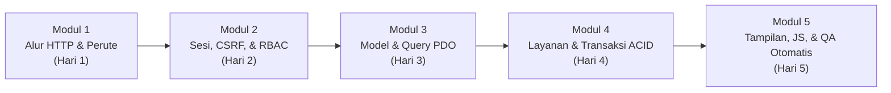

# Alur Belajar, Bedah Kode Hulu-ke-Hilir, & Modul Praktikum Siswa RPL

Dokumen ini dirancang khusus sebagai **peta jalan belajar (*Learning Path*)** agar siswa SMK Rekayasa Perangkat Lunak (RPL) dapat memahami arsitektur **Bank Mini** secara bertahap, tidak bingung harus mulai dari file mana, serta mudah beradaptasi saat mendapat tugas membuat fitur baru.

---

## 1. Peta Jalan Belajar 5 Modul (*5-Stage Learning Path*)

Jika kamu baru pertama kali membuka projek ini, **jangan langsung membaca semua file sekaligus**. Ikuti urutan 5 modul di bawah ini:



| Modul | Fokus Kompetensi RPL | Urutan File Kode yang Wajib Dibaca | Dokumen Pendamping |
| :--- | :--- | :--- | :--- |
| **Modul 1: Pintu Masuk & Perutean HTTP** | Memahami *Single Entry Point*, *Front Controller*, dan bagaimana URL dipetakan ke *Controller*. | 1. [`konfigurasi/aplikasi.php`](../../konfigurasi/aplikasi.php)<br>2. [`public/index.php`](../../public/index.php)<br>3. [`aplikasi/Inti/Perute.php`](../../aplikasi/Inti/Perute.php)<br>4. [`aplikasi/Inti/PengendaliDasar.php`](../../aplikasi/Inti/PengendaliDasar.php) | [`arsitektur-sistem.md`](./arsitektur-sistem.md) |
| **Modul 2: Keamanan Sesi, RBAC, & CSRF** | Memahami proteksi sesi login, pembagian hak akses petugas (`admin`, `teller`, `supervisor`), dan pencegahan pemalsuan form. | 1. [`aplikasi/Inti/Sesi.php`](../../aplikasi/Inti/Sesi.php)<br>2. [`aplikasi/Inti/TokenCsrf.php`](../../aplikasi/Inti/TokenCsrf.php)<br>3. [`aplikasi/Inti/MiddlewareAutentikasi.php`](../../aplikasi/Inti/MiddlewareAutentikasi.php)<br>4. [`aplikasi/Layanan/LayananAutentikasi.php`](../../aplikasi/Layanan/LayananAutentikasi.php) | [`standar-kode-dan-keamanan.md`](./standar-kode-dan-keamanan.md) |
| **Modul 3: Basis Data InnoDB & Lapisan Model** | Memahami koneksi *Singleton PDO*, *Prepared Statements* (anti SQL Injection), dan relasi tabel. | 1. [`basis_data/skema.sql`](../../basis_data/skema.sql)<br>2. [`aplikasi/Inti/BasisData.php`](../../aplikasi/Inti/BasisData.php)<br>3. [`aplikasi/Model/ModelNasabah.php`](../../aplikasi/Model/ModelNasabah.php)<br>4. [`aplikasi/Model/ModelRekening.php`](../../aplikasi/Model/ModelRekening.php) | [`skema-database.md`](./skema-database.md) & [`glosarium-dan-daftar-istilah.md`](./glosarium-dan-daftar-istilah.md) |
| **Modul 4: Logika Bisnis & Transaksi ACID Rupiah** | Memahami mengapa hitungan uang wajib memakai `BCMath` (`DECIMAL(15,2)`), `SELECT ... FOR UPDATE`, dan buku besar *Append-Only*. | 1. [`aplikasi/Pembantu/fungsi_umum.php`](../../aplikasi/Pembantu/fungsi_umum.php)<br>2. [`aplikasi/Layanan/LayananRekening.php`](../../aplikasi/Layanan/LayananRekening.php)<br>3. [`aplikasi/Layanan/LayananTransaksi.php`](../../aplikasi/Layanan/LayananTransaksi.php)<br>4. [`aplikasi/Pengendali/PengendaliTransaksi.php`](../../aplikasi/Pengendali/PengendaliTransaksi.php) | [`dfd-dan-alur-sistem.md`](./dfd-dan-alur-sistem.md) |
| **Modul 5: UI/UX Bootstrap 5 & Quality Gate** | Memahami pemisahan tampilan HTML, pratinjau Rupiah *real-time*, serta cara kerja pengujian otomatis (`PHPCS`, `PHPStan`, `Playwright`). | 1. [`aplikasi/Tampilan/tata_letak/kepala.php`](../../aplikasi/Tampilan/tata_letak/kepala.php)<br>2. [`public/aset/js/aplikasi.js`](../../public/aset/js/aplikasi.js)<br>3. [`pengujian/Integrasi/TesLayananTransaksi.php`](../../pengujian/Integrasi/TesLayananTransaksi.php)<br>4. [`pengujian/e2e/alur_keuangan.spec.js`](../../pengujian/e2e/alur_keuangan.spec.js) | [`standar-frontend-ui-ux.md`](./standar-frontend-ui-ux.md) & [`standar-pengujian-qa.md`](./standar-pengujian-qa.md) |

---

## 2. Bedah 1 Fitur dari Hulu ke Hilir (*End-to-End Walkthrough*: Setor Tunai Rp 50.000)

Mari kita telusuri **apa yang sebenarnya terjadi baris demi baris** ketika seorang Teller melakukan **Setor Tunai Rp 50.000**:

### Langkah A — Di Browser (Tampilan & Vanilla JS)
1. Teller membuka halaman `/transaksi/setor` yang dirender oleh [`aplikasi/Tampilan/transaksi/setor_tunai.php`](../../aplikasi/Tampilan/transaksi/setor_tunai.php).
2. Saat Teller memilih rekening di dropdown (`data-target-info-saldo`), skrip [`public/aset/js/aplikasi.js`](../../public/aset/js/aplikasi.js) langsung menampilkan kartu **Saldo Saat Ini**, **Saldo Mengendap**, dan **Saldo Efektif**.
3. Saat Teller mengetik `50000` pada input `#nominal_setoran` (`data-pratinjau-rupiah`), skrip menampilkan teks **`Terbaca: Rp 50.000`** agar Teller tidak salah ketik nol.
4. Saat tombol **Simpan Setoran** diklik, muncul **Modal Konfirmasi Transaksi** (`#modalKonfirmasiTransaksi`). Setelah Teller menekan **Ya, Proses Sekarang**, browser mengirim request `POST /transaksi/setor` beserta `token_csrf`.

### Langkah B — Pintu Masuk & Perute (`public/index.php` -> `Perute.php`)
5. Semua request masuk ke [`public/index.php`](../../public/index.php). Di sini sesi dimulai, autoloader PSR-4 didaftarkan, dan daftar rute didaftarkan:
   ```php
   $perute->tambahRute('POST', '/transaksi/setor', PengendaliTransaksi::class, 'prosesSetorTunai');
   ```
6. [`Perute::jalankan()`](../../aplikasi/Inti/Perute.php) mencocokkan metode `POST` dan jalur `/transaksi/setor`, lalu memanggil `PengendaliTransaksi::prosesSetorTunai()`.

### Langkah C — Pengendali HTTP (`PengendaliTransaksi.php`)
7. Di dalam [`PengendaliTransaksi::prosesSetorTunai()`](../../aplikasi/Pengendali/PengendaliTransaksi.php):
   - Memastikan petugas memiliki peran `admin` atau `teller` via `MiddlewareAutentikasi::wajibPeran(['admin', 'teller'])`.
   - Memvalidasi token CSRF via `$this->wajibValidasiCsrf()`.
   - Mengambil `$_POST['id_rekening']` dan `$_POST['nominal_setoran']`, lalu menyerahkannya ke [`LayananTransaksi::prosesSetorTunai()`](../../aplikasi/Layanan/LayananTransaksi.php). *(Ingat: Pengendali dilarang menulis SQL!)*

### Langkah D — Layanan Bisnis & Transaksi ACID (`LayananTransaksi.php`)
8. Di dalam [`LayananTransaksi::prosesSetorTunai()`](../../aplikasi/Layanan/LayananTransaksi.php):
   - Memvalidasi bahwa nominal adalah angka desimal positif melalui `validasiNominalPositifRupiah('50000')` -> menghasilkan `'50000.00'`.
   - Membuka transaksi database: `$this->koneksi->beginTransaction()`.
   - Mengunci baris rekening di MySQL InnoDB: `$this->modelRekening->kunciRekeningUntukPembaruan($idRekening)` (`SELECT ... FOR UPDATE`) agar tidak terjadi *Race Condition*.
   - Menghitung saldo baru dengan presisi tinggi `BCMath`:
     ```php
     $saldoSebelum = keStringNumerik($dataRekening['saldo']);
     $saldoSesudah = bcadd($saldoSebelum, $nominalNormal, 2);
     ```
   - Menyimpan baris mutasi baru (`KREDIT`) ke tabel `mutasi_transaksi` via `ModelMutasi::simpanMutasiBaru()`.
   - Memperbarui kolom `rekening.saldo` via `ModelRekening::perbaruiSaldoRekening()`.
   - Mencatat jejak audit ke tabel `log_audit` via `ModelLogAudit::catatLog()`.
   - Menyimpan permanen seluruh perubahan: `$this->koneksi->commit()`. (Jika ada 1 langkah saja yang error, blok `catch` otomatis memanggil `rollBack()`!).

### Langkah E — Pola PRG (*Post-Redirect-Get*)
9. Kembali di `PengendaliTransaksi`, sistem menyimpan pesan sukses ke *Flash Session* (`Sesi::tetapkanPesanKilat(...)`) dan mengalihkan browser (`HTTP 302 Redirect`) kembali ke `GET /transaksi/setor` agar jika Teller menekan tombol `F5` (Refresh), setoran Rp 50.000 tidak terduplikasi!

---

## 3. Resep 6 Langkah Menambah Fitur Baru (*Cookbook Adaptasi Cepat*)

Setiap kali kamu diminta menambahkan fitur baru di projek ini, ikuti **6 langkah baku** berikut agar kodemu langsung lolos semua *Quality Gate*:

1. **Cek / Tambah Metode di `Model` (`aplikasi/Model/`)**:
   - Gunakan PDO Prepared Statements (`prepare()` + `execute()`), jangan pernah menggabungkan variabel langsung ke string SQL.
2. **Tulis Logika Bisnis di `Layanan` (`aplikasi/Layanan/`)**:
   - Tambahkan PHPDoc kelas dengan tag `@konsep_rpl` (minimal 40 karakter) dan komentar langkah `// [Langkah X - Konsep RPL]: ...`.
   - Jika mengubah saldo Rupiah, wajib di dalam `beginTransaction()` + `kunciRekeningUntukPembaruan()` + `bcadd`/`bcsub` (`keStringNumerik()`).
3. **Buat / Tambah Aksi di `Pengendali` (`aplikasi/Pengendali/`)**:
   - Cek hak akses dengan `MiddlewareAutentikasi`, validasi CSRF untuk metode `POST`, panggil `Layanan`, dan akhiri `POST` dengan `$this->alihkan(...)` (pola PRG).
4. **Buat Tampilan di `aplikasi/Tampilan/` & Daftarkan Rute di `public/index.php`**:
   - Awali file tampilan dengan blok komentar `<?php /** ... */ ?>` (minimal 20 karakter).
   - Bungkus semua variabel output dengan `amankanHtml($nilai)` dan nominal uang dengan `formatRupiah($nominal)`.
5. **Tulis Tes Otomatis (`pengujian/`)**:
   - Jika membuat `Layanan<Nama>.php` baru, wajib membuat `pengujian/Integrasi/TesLayanan<Nama>.php` dan mendaftarkannya di `pengujian/jalankan_semua_tes.php`.
6. **Jalankan Quality Gate Lokal Sebelum Commit**:
   ```powershell
   powershell -ExecutionPolicy Bypass -File .\dokumentasi\06-aturan-agen\skrip\periksa-konsistensi.ps1 -DenganE2E
   ```

---

## 4. Lembar Kerja & 5 Tantangan Praktikum Siswa RPL (*Lab Exercises*)

Guru atau siswa dapat menggunakan 5 skenario latihan bertingkat ini untuk menguji pemahaman:

| Level | Tantangan Praktikum | File yang Dipelajari / Dimodifikasi | Kriteria Lulus (Verifikasi) |
| :--- | :--- | :--- | :--- |
| **Latihan 1 (Dasar)** | **Filter Pencarian Kelas pada Daftar Nasabah**: Tambahkan filter *dropdown* atau input pencarian berdasarkan `kelas_atau_unit` di halaman `/nasabah`. | `ModelNasabah.php`, `PengendaliNasabah.php`, `Tampilan/nasabah/indeks.php` | Output di-*escape* dengan `amankanHtml()`, query menggunakan `prepare()`, dan lulus `composer qa`. |
| **Latihan 2 (Dasar)** | **Ringkasan Total Mutasi Kredit & Debit di Halaman Laporan**: Tampilkan total nominal `KREDIT` dan `DEBIT` menggunakan `bcadd()` pada halaman `/laporan/mutasi`. | `PengendaliLaporan.php`, `Tampilan/laporan/mutasi.php` | Perhitungan wajib memakai `bcadd()` + `keStringNumerik()`, lulus `PHPStan Level 8`. |
| **Latihan 3 (Menengah)** | **Penutupan / Penonaktifan Rekening dengan Validasi Saldo**: Buat fitur ubah status rekening menjadi `ditutup` yang hanya diizinkan oleh peran `admin` atau `supervisor`. | `LayananRekening.php`, `PengendaliRekening.php`, `TesLayananRekening.php` | Tercatat di `log_audit`, diuji di `TesLayananRekening.php`, lulus `100%` tes QA. |
| **Latihan 4 (Menengah)** | **Halaman Log Audit Khusus Admin/Supervisor**: Buat rute `GET /laporan/audit` untuk menampilkan 50 catatan terbaru dari tabel `log_audit`. | `ModelLogAudit.php`, `PengendaliLaporan.php`, `Tampilan/laporan/audit.php`, `public/index.php` | Peran `teller` ditolak (`403`), `admin` & `supervisor` dapat melihat tabel audit. |
| **Latihan 5 (Mahir)** | **Pengujian E2E Playwright untuk Transfer Antar Rekening**: Tambahkan skenario uji baru di `pengujian/e2e/alur_keuangan.spec.js` yang menguji transfer antar 2 rekening. | `pengujian/e2e/alur_keuangan.spec.js` | `npm run test:e2e` lulus 100% dengan `0 Console Error` & `0 Console Warning`. |

---

## 5. Solusi Masalah Umum Siswa (*Troubleshooting / FAQ*)

1. **Pesan `SQLSTATE[HY000] [2002] No connection could be made`**:
   - Penyebab: Layanan **MySQL** di XAMPP Control Panel belum dinyalakan (*Start*), atau belum menjalankan skrip instalasi database.
   - Solusi: Nyalakan MySQL di XAMPP, lalu jalankan `C:\xampp\php\php.exe basis_data\pasang_basis_data.php`.
2. **Commit Ditolak oleh `[GIT PRE-COMMIT GATE]`**:
   - Penyebab: Ada aturan penamaan Bahasa Indonesia yang terlewat (misal variabel bahasa Inggris `$user` atau `$snake_case`), kurang anotasi `@konsep_rpl`, atau ada *warning/error* di PHPCS/PHPStan.
   - Solusi: Baca baris pelanggaran yang dicetak di terminal, perbaiki hingga bersih (`0 Error & 0 Warning`), lalu ulangi `git commit`.
3. **Ingin Menyiapkan Ulang Seluruh Projek dengan 1 Perintah**:
   - Jalankan skrip onboarding otomatis:
     ```powershell
     powershell -ExecutionPolicy Bypass -File .\dokumentasi\06-aturan-agen\skrip\siapkan-projek.ps1
     ```

