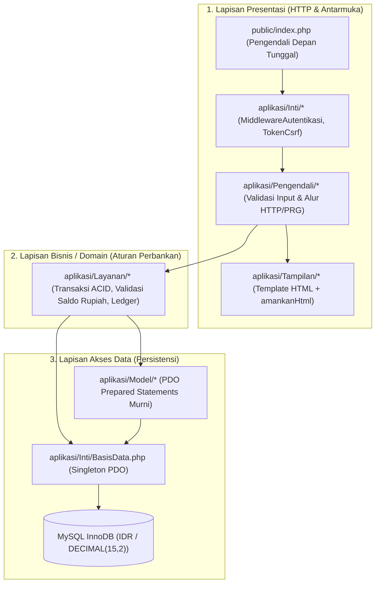

# Arsitektur Sistem, SoT, dan SoC (`bankmini`)

Meskipun menggunakan **PHP Native** (tanpa framework eksternal), sistem **Bank Mini** dirancang dengan disiplin rekayasa perangkat lunak melalui prinsip **Single Source of Truth (SoT)** dan **Separation of Concerns (SoC)** menggunakan pola **Layered MVC-Lite + Service Layer** dengan penamaan **Bahasa Indonesia**.

---

## 1. Perencanaan Single Source of Truth (SoT)

**Single Source of Truth (SoT)** menjamin setiap elemen data, konfigurasi, dan aturan bisnis hanya memiliki **satu sumber acuan resmi** sehingga tidak ada inkonsistensi di seluruh aplikasi.

| Domain / Aspek | Single Source of Truth (SoT) | Lokasi / Implementasi | Aturan Turunan (Derived State) |
| :--- | :--- | :--- | :--- |
| **1. Saldo & Mutasi Uang** | Tabel `mutasi_transaksi` (*Immutable Ledger*) | Database MySQL (`mutasi_transaksi`) | Kolom `rekening.saldo` adalah *cached balance* yang **hanya** boleh diperbarui bersamaan dengan `INSERT` ke `mutasi_transaksi` di dalam satu transaksi ACID (`LayananTransaksi`). |
| **2. Mata Uang & Format** | Mata Uang Tunggal **Rupiah (`IDR`)** dengan tipe DB `DECIMAL(15,2)` | `konfigurasi/aplikasi.php` (`MATA_UANG = 'IDR'`) & `aplikasi/Pembantu/fungsi_umum.php` (`formatRupiah()`) | Seluruh transaksi dalam sistem menggunakan mata uang **Rupiah (IDR)**. Dilarang memformat `"Rp ..."` di Model/Layanan; pemformatan tampilan hanya dilakukan di Tampilan (View) melalui helper `formatRupiah()`. |
| **3. Konfigurasi & Lingkungan** | File konfigurasi terpusat | `konfigurasi/aplikasi.php` & `konfigurasi/basis_data.php` | Dilarang melakukan *hardcode* kredensial DB, zona waktu (`Asia/Jakarta`), atau `URL_DASAR` di file Pengendali/Model/Tampilan. |
| **4. Koneksi Database** | Instance tunggal PDO (`BasisData::ambilKoneksi()`) | `aplikasi/Inti/BasisData.php` | Dilarang membuat `new PDO(...)` di luar `aplikasi/Inti/BasisData.php` agar transaksi (`beginTransaction`) selalu berjalan pada koneksi yang sama. |
| **5. Peta Rute & Akses** | Definisi rute terpusat | `public/index.php` & `aplikasi/Inti/Perute.php` | Seluruh HTTP request wajib melewati `public/index.php`. File di dalam `aplikasi/` tidak boleh diakses langsung via URL browser. |
| **6. Hak Akses & Sesi** | Manajer Sesi & Guard RBAC | `aplikasi/Inti/Sesi.php` & `aplikasi/Inti/MiddlewareAutentikasi.php` | Pengecekan status masuk dan peran (`admin`, `teller`, `supervisor`, `nasabah`) hanya merujuk pada `MiddlewareAutentikasi`, bukan dicek manual berulang-ulang dengan `$_SESSION` mentah di Tampilan. |
| **7. Dokumentasi & Aturan** | Repositori Dokumentasi | `C:\xampp\htdocs\www\bankmini\dokumentasi` | Skema DB di `basis_data/skema.sql` harus selalu identik dengan `02-panduan-dev/skema-database.md`. |

---

## 2. Perencanaan Separation of Concerns (SoC)

**Separation of Concerns (SoC)** memisahkan kode ke dalam lapisan (*layers*) berbahasa Indonesia dengan batas tanggung jawab yang tegas dan arah ketergantungan satu arah (*unidirectional dependency*).



### Matriks Tanggung Jawab & Batasan Tiap Lapisan (SoC Matrix)

| Lapisan (Layer) | Lokasi Folder | Tanggung Jawab Utama (Boleh Dilakukan) | Larangan Keras (Tidak Boleh Dilakukan) |
| :--- | :--- | :--- | :--- |
| **Pengendali Depan & Inti** | `public/index.php`, `aplikasi/Inti/` | Inisialisasi sesi aman, memuat konfigurasi, verifikasi token CSRF & RBAC, mengarahkan URL ke `Pengendali`. | Menulis logika bisnis tabungan atau merender HTML halaman fitur. |
| **Pengendali (Controller)** | `aplikasi/Pengendali/` | Membaca `$_GET`/`$_POST`, validasi format input dasar, memanggil `Layanan`, mengatur pesan kilat (*flash message*), melakukan `alihkan()` (PRG) atau memanggil `Tampilan`. | **Dilarang** menulis query SQL, **dilarang** memanggil `beginTransaction()`, **dilarang** menghitung saldo, **dilarang** mencetak tag HTML langsung. |
| **Layanan (Service)** | `aplikasi/Layanan/` | Membuka & menutup transaksi DB (`beginTransaction`, `commit`, `rollBack`), menerapkan aturan bisnis Bank Mini (cek saldo efektif Rupiah, kunci baris rekening, buat kode referensi, catat mutasi & log audit). | **Dilarang** mengakses `$_POST`/`$_GET`/`$_SESSION` secara langsung, **dilarang** merender HTML/redirect HTTP. |
| **Model (Data Access)** | `aplikasi/Model/` | Menjalankan query SQL (`SELECT`, `INSERT`, `UPDATE`) menggunakan PDO Prepared Statements (termasuk `SELECT ... FOR UPDATE`). | **Dilarang** mengatur `commit()`/`rollBack()` sendiri (harus dikendalikan oleh `Layanan`), **dilarang** berisi aturan bisnis atau HTML. |
| **Tampilan (View)** | `aplikasi/Tampilan/` | Menampilkan data yang dikirim `Pengendali` ke dalam HTML menggunakan helper `amankanHtml()` dan `formatRupiah()`. | **Dilarang keras** menjalankan query SQL, memanggil `Model`/`Layanan`, atau mengubah isi `$_SESSION`. |
| **Pembantu (Helpers)** | `aplikasi/Pembantu/` | Fungsi murni tanpa efek samping (*stateless*): `amankanHtml()` (XSS escape), `formatRupiah()`, `formatTanggalIndonesia()`. | **Dilarang** melakukan koneksi database atau mutasi state. |

---

## 3. Struktur Folder `C:\xampp\htdocs\www\bankmini` (Bahasa Indonesia)

```text
C:\xampp\htdocs\www\bankmini\
├── public/                        # Document Root / Satu-satunya pintu masuk publik Apache
│   ├── index.php                  # Pengendali Depan (Front Controller) tunggal
│   ├── .htaccess                  # Rewrite URL ke index.php
│   └── aset/                      # File statis (css/, js/, vendor/ Bootstrap 5 offline)
├── konfigurasi/                   # SoT Konfigurasi Aplikasi
│   ├── aplikasi.php               # Zona waktu Asia/Jakarta, mata uang IDR, URL_DASAR
│   └── basis_data.php             # Konfigurasi koneksi PDO MySQL InnoDB
├── aplikasi/                      # Kode inti aplikasi (terproteksi dari akses URL langsung)
│   ├── Inti/                      # Pondasi infrastruktur (Core)
│   │   ├── Perute.php             # SoT Pemetaan rute URL & metode HTTP
│   │   ├── BasisData.php          # SoT Koneksi PDO Singleton
│   │   ├── Sesi.php               # SoT Manajemen Sesi & Pesan Kilat (Flash Message)
│   │   ├── TokenCsrf.php          # Generator & validator token CSRF
│   │   ├── MiddlewareAutentikasi.php # SoT Autentikasi & Pemeriksaan Peran (RBAC)
│   │   └── PengendaliDasar.php    # Class induk Pengendali (tampilkanView, alihkan PRG)
│   ├── Pengendali/                # Lapisan HTTP (Controllers)
│   │   ├── PengendaliAutentikasi.php
│   │   ├── PengendaliDasbor.php
│   │   ├── PengendaliNasabah.php
│   │   ├── PengendaliProduk.php
│   │   ├── PengendaliRekening.php
│   │   ├── PengendaliTransaksi.php
│   │   ├── PengendaliLaporan.php
│   │   └── PengendaliDokumentasi.php # Pembaca & pencari dokumentasi terindeks di browser (/dokumentasi)
│   ├── Layanan/                   # Lapisan Logika Bisnis & Batas Transaksi ACID (Services)
│   │   ├── LayananAutentikasi.php
│   │   ├── LayananDokumenKantor.php # Adapter Ekspor/Impor/Cetak PDF (Dompdf), Excel (SimpleXLSX/PhpSpreadsheet), & Word (PhpWord)
│   │   ├── LayananDokumentasi.php # Pengindeks katalog .md, parser Markdown, & Anti-Path Traversal
│   │   ├── LayananRekening.php    # Registrasi & pembuatan nomor rekening unik
│   │   └── LayananTransaksi.php   # Setor, Tarik, Transfer, & Jurnal Koreksi (Rupiah/IDR)
│   ├── Model/                     # Lapisan Akses Data (PDO Prepared Statements)
│   │   ├── ModelPengguna.php
│   │   ├── ModelNasabah.php
│   │   ├── ModelProduk.php
│   │   ├── ModelRekening.php
│   │   ├── ModelMutasi.php
│   │   └── ModelLogAudit.php
│   ├── Pembantu/                  # Fungsi utilitas murni (stateless)
│   │   └── fungsi_umum.php        # amankanHtml(), formatRupiah(), formatTanggalIndonesia(), keStringNumerik()
│   └── Tampilan/                  # Template Antarmuka (HTML murni + variabel ter-escape)
│       ├── tata_letak/            # kepala.php, bilah_sisi.php, kaki.php
│       ├── autentikasi/
│       ├── dasbor/
│       ├── nasabah/
│       ├── produk/
│       ├── rekening/
│       ├── transaksi/
│       ├── laporan/
│       └── dokumentasi/           # Pembaca dokumen 3-kolom + daftar isi otomatis (indeks.php)
├── basis_data/                    # SoT Skema & Data Awal Database
│   ├── skema.sql                  # DDL InnoDB berbahasa Indonesia (nominal IDR DECIMAL(15,2))
│   └── data_awal.sql              # Data awal (Admin, Teller, Produk Tabungan IDR)
├── pengujian/                     # Suite Pengujian Otomatis QA (Bahasa Indonesia)
│   ├── jalankan_semua_tes.php     # Test Runner CLI tunggal (strict E_ALL Zero Warning)
│   ├── PembantuPengujian/         # KasusUjiDasar.php & BasisDataMemoriUji.php
│   ├── Unit/                      # TesFungsiUmum.php, TesTokenCsrf.php, TesLayananDokumenKantor.php
│   ├── Integrasi/                 # TesLayananAutentikasi.php, TesLayananDokumentasi.php, TesLayananRekening.php, TesLayananTransaksi.php
│   ├── Keamanan/                  # TesKeamananAplikasi.php
│   └── e2e/                       # Smoke Test & E2E Playwright (smoke.spec.js, alur_keuangan.spec.js)
├── penyimpanan/                   # Penyimpanan internal aplikasi
│   ├── log/                       # Log error & aktivitas aplikasi
│   └── cadangan/                  # Hasil cadangan (backup) database
├── dokumentasi/                   # Dokumentasi arsitektur, DFD/ERD, panduan, ADR, work log, & skrip penjaga
├── composer.json / phpcs.xml      # Konfigurasi Composer, PSR-12 Lint Zero-Warning (PHPCS), & PHPStan Level 8
├── phpstan.neon                   # Konfigurasi analisis statis PHPStan (naik bertahap: Level 5 -> 6 -> 7 -> 8)
├── .githooks/                     # Git Hook pemblokir commit & push jika QA Gate gagal
├── package.json / playwright.config.js # Konfigurasi Playwright Browser Testing
└── .htaccess                      # Mengarahkan seluruh trafik ke folder public/
```

---

## 4. Prasyarat Lingkungan & Perkakas Pengembangan (*Environment Prerequisites*)

Agar aplikasi **Bank Mini** dan seluruh gerbang verifikasi (*Quality Gate*) berjalan konsisten di komputer siswa RPL maupun pengembang/CI, berikut prasyarat lingkungan yang wajib dipenuhi:

### 4.1 Lingkungan Runtime Aplikasi (Wajib di Lab / Server Produksi Sekolah)

| Komponen | Versi Minimum / Disarankan | Catatan Teknis |
| :--- | :--- | :--- |
| **Web Server** | Apache `2.4+` (XAMPP) atau PHP Built-in Server | Pastikan modul `mod_rewrite` aktif agar `public/.htaccess` mengarahkan seluruh request ke `public/index.php`. |
| **PHP** | **PHP `>= 8.2`** (Teruji pada `8.5.12`) | Mendukung *strict types*, *named arguments*, dan union types modern. |
| **Ekstensi PHP Wajib** | `pdo_mysql`, `bcmath`, `mbstring`, `openssl`, `tokenizer`, `dom`, `zlib` | `pdo_mysql` (PDO native prepares), `bcmath` (kalkulasi akurat Rupiah `DECIMAL(15,2)`), `dom` & `zlib` (mesin PDF/Excel/Word tanpa wajib ubah `php.ini`). |
| **Pustaka Dokumen (PDF, Excel, Word)** | `dompdf/dompdf` (`^3.1`), `phpoffice/phpspreadsheet` (`^5.11`), `shuchkin/simplexlsxgen` (`^1.5`), `shuchkin/simplexlsx` (`^1.1`), `phpoffice/phpword` (`^1.4`) | Dibungkus oleh `Aplikasi\Layanan\LayananDokumenKantor` dengan fallback otomatis `PCLZip` (`ext-zlib`) untuk ekspor, impor, dan cetak dokumen. |
| **Basis Data** | MySQL `8.0+` / MariaDB `10.4+` | Wajib menggunakan engine **InnoDB** (`SELECT ... FOR UPDATE` & ACID) dan charset `utf8mb4`. |
| **Aset Frontend** | **100% Offline** (`public/aset/vendor/`) | Bootstrap `5.3.3` & Bootstrap Icons `1.11.3` sudah terbundel lokal sehingga tidak bergantung internet / Node.js saat aplikasi dijalankan. |

### 4.2 Perkakas Quality Gate, Lint, Static Analysis, & E2E (Lingkungan Pengembangan / QA)

| Perkakas | Versi / Paket | File Konfigurasi | Tujuan Pemeriksaan |
| :--- | :--- | :--- | :--- |
| **Composer** + PHP `ext-zip` | Composer `2.x` (`squizlabs/php_codesniffer`, `phpstan/phpstan`) | `composer.json`, `phpcs.xml`, `phpstan.neon` | Menjalankan linter PSR-12 **0 Error & 0 Warning** (`composer lint`) dan analisis statis **PHPStan Level 8** bertahap (`composer stan`). |
| **Git Hooks** | Git `>= 2.9` | `.githooks/pre-commit`, `.githooks/pre-push` | Memblokir `git commit` dan `git push` otomatis jika masih terdapat *bug*, *error*, atau *warning* QA. |
| **Node.js LTS + npm** | Node.js `>= 22.x LTS` (`@playwright/test`) | `package.json`, `playwright.config.js` | Menjalankan browser smoke test & end-to-end transaksi nyata (`npm run test:e2e`). |
| **Browser Uji** | Google Chrome / Chromium lokal | `channel: 'chrome'` di `playwright.config.js` | Diperlukan oleh Playwright untuk merender halaman, menguji CSS offline, memeriksa kontras, dan mengambil screenshot uji. |
| **Skrip Penjaga Internal** | PHP CLI (`C:\xampp\php\php.exe`) | `dokumentasi/06-aturan-agen/skrip/` | Menjalankan `gerbang_handover_agen.php`, `periksa_kepatuhan_agen.php`, `periksa-konsistensi.ps1`, dan `naikkan_versi.php`. |

### 4.3 Daftar Perintah Verifikasi Lingkungan Baru

```powershell
# 1. Validasi Entry Gate & Prasyarat Runtime (PHP, Ekstensi, Vendor, Node)
C:\xampp\php\php.exe C:\xampp\htdocs\www\bankmini\dokumentasi\06-aturan-agen\skrip\gerbang_handover_agen.php

# 2. Pasang dependensi Dev/QA (jika kloning repo baru)
composer install
npm install

# 3. Jalankan Quality Gate lengkap sebelum commit
composer lint
composer stan
composer test
composer patuh
npm run test:e2e
```
