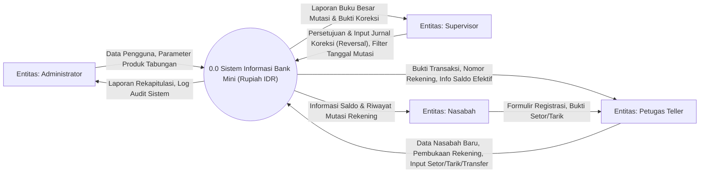
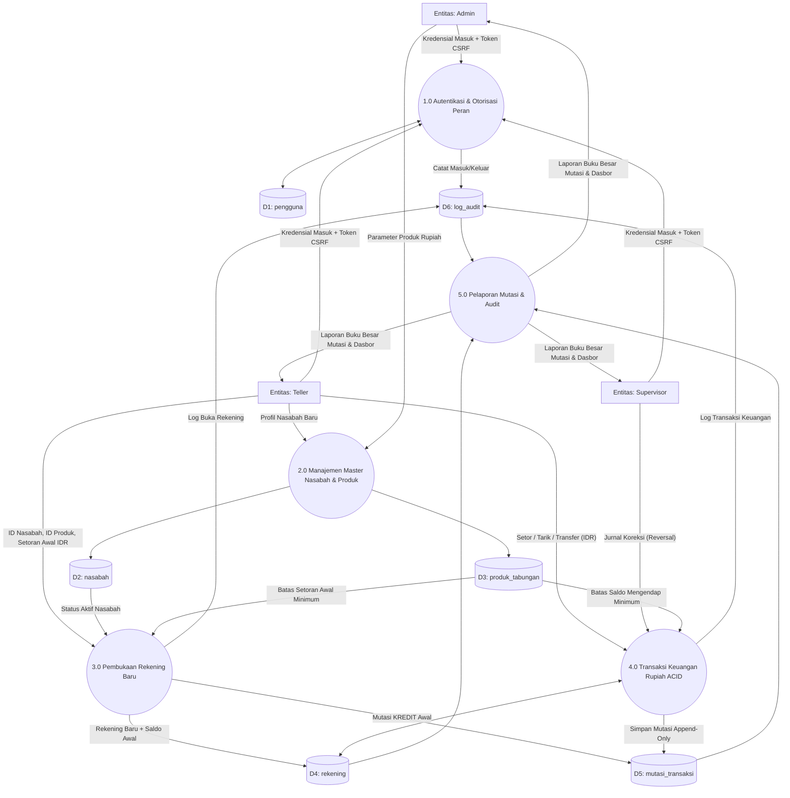
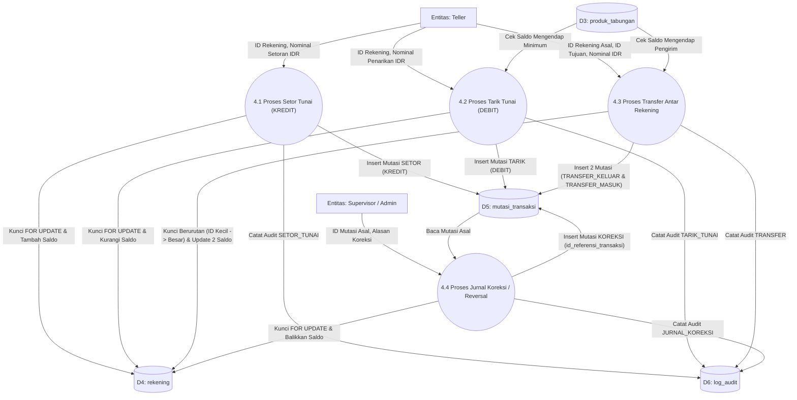
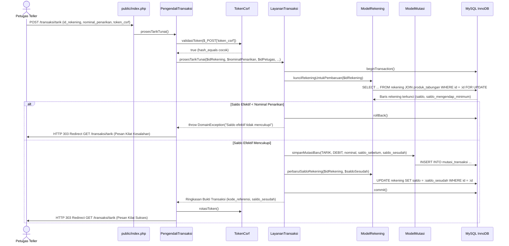
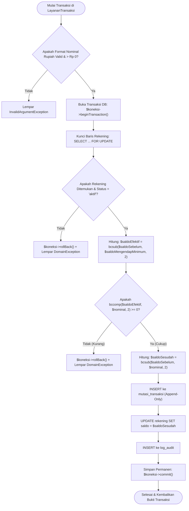

# Data Flow Diagram (DFD), Sequence Diagram, & Alur Sistem — Bahan Belajar RPL

Dokumen ini disusun khusus sebagai **materi pembelajaran Rekayasa Perangkat Lunak (RPL)** untuk memahami pemodelan alur data dan proses bisnis pada **Sistem Informasi Bank Mini (PHP Native)**.

---

## 1. Perbedaan DFD, ERD, dan Flowchart (Konsep Dasar RPL)

Sebelum membaca diagram di bawah ini, siswa RPL perlu memahami perbedaan fungsi ketiga diagram pemodelan perangkat lunak:

| Jenis Diagram | Fokus Pemodelan | Pertanyaan yang Dijawab |
| :--- | :--- | :--- |
| **DFD (*Data Flow Diagram*)** | **Aliran data** dari pengguna luar, melewati proses, menuju tempat penyimpanan data (*Data Store*). | *"Dari mana data berasal, diproses oleh modul apa, dan disimpan ke tabel mana?"* |
| **ERD (*Entity Relationship Diagram*)** | **Struktur data & relasi antar tabel** di dalam basis data. | *"Tabel apa saja yang ada di database dan bagaimana hubungan antar tabel tersebut?"* |
| **Flowchart / Sequence Diagram** | **Urutan langkah algoritma** dan interaksi antar objek/lapisan kode (`Pengendali -> Layanan -> Model`). | *"Bagaimana urutan logika program dari awal hingga akhir (termasuk percabangan `if/else`)?"* |

---

## 2. DFD Level 0 (Diagram Konteks / Context Diagram)

**Diagram Konteks (DFD Level 0)** memandang seluruh aplikasi **Bank Mini** sebagai satu proses tunggal (`0.0 Sistem Informasi Bank Mini`) yang berinteraksi dengan 4 **Entitas Eksternal (Terminator)**:
1. **Administrator (`admin`)**
2. **Petugas Teller (`teller`)**
3. **Supervisor (`supervisor`)**
4. **Nasabah (`nasabah`)**

---

## 3. DFD Level 1 (Dekomposisi Proses Utama)

Pada **DFD Level 1**, proses tunggal `0.0` dipecah menjadi **5 Proses Utama (`1.0` s.d. `5.0`)** dan **6 Penyimpanan Data (*Data Store* `D1` s.d. `D6`)** yang merepresentasikan tabel di MySQL InnoDB:

---

## 4. DFD Level 2 — Rincian Proses `4.0 Transaksi Keuangan Rupiah ACID`

Proses `4.0` merupakan jantung dari sistem perbankan dan dipecah lagi menjadi 4 sub-proses (`4.1` s.d. `4.4`) yang berada di dalam `aplikasi/Layanan/LayananTransaksi.php`:

---

## 5. Sequence Diagram: Siklus Transaksi Tarik Tunai (SoC & ACID)

Diagram urutan (*Sequence Diagram*) berikut memperlihatkan bagaimana sebuah klik tombol **"Proses Tarik Tunai"** mengalir melintasi lapisan arsitektur (`Pengendali -> Layanan -> Model -> MySQL InnoDB`) dengan pola **PRG (Post-Redirect-Get)**:

---

## 6. Flowchart Algoritma Perhitungan Saldo Efektif & Penguncian Anti-Deadlock

