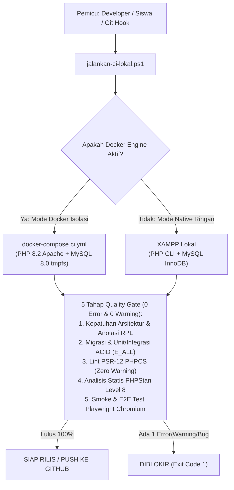

# Panduan CI/CD Lokal Berbasis Docker & Native (Tanpa Kuota GitHub Runner)

Dokumen ini menjelaskan arsitektur dan cara penggunaan **Pipeline Continuous Integration / Continuous Delivery (CI/CD) Lokal** pada projek **Bank Mini**.

> [!IMPORTANT]
> Akun GitHub gratis memiliki batas menit eksekusi (*runner quota limit*) dan antrean cloud yang sering menghambat kegiatan praktikum kelas SMK. Karena itu, projek Bank Mini menerapkan **Dual-Engine Local CI/CD Pipeline** yang berjalan **100% di komputer lokal / server lab sekolah** tanpa memakai kuota GitHub Actions sedikit pun.

---

## 1. Arsitektur Dual-Engine Local CI/CD

Skrip [`jalankan-ci-lokal.ps1`](../06-aturan-agen/skrip/jalankan-ci-lokal.ps1) mendukung dua mesin eksekusi yang dapat dipilih otomatis sesuai spesifikasi perangkat:



---

## 2. Berkas Infrastruktur Docker & CI Lokal

| Berkas | Fungsi Utama |
| :--- | :--- |
| [`Dockerfile`](../../Dockerfile) | Membangun image `php:8.2-apache` dengan ekstensi `pdo_mysql`, `bcmath`, `zip`, `mod_rewrite`, Composer 2, dan `DocumentRoot` pada `/var/www/html/public`. |
| [`docker-compose.yml`](../../docker-compose.yml) | Menjalankan server pengembangan & belajar harian di port `http://localhost:8080` beserta database MySQL 8.0 (`port 33060`) yang otomatis mengimpor `skema.sql` dan `data_awal.sql`. |
| [`docker-compose.ci.yml`](../../docker-compose.ci.yml) | Stack khusus pengujian CI terisolasi menggunakan `tmpfs` (database di RAM sehingga sangat cepat dan selalu bersih dari nol). |
| [`jalankan-ci-lokal.ps1`](../06-aturan-agen/skrip/jalankan-ci-lokal.ps1) | Orkestrator CI/CD lokal satu perintah dengan dukungan `-Mode otomatis`, `-Mode docker`, dan `-Mode native`. |
| [`.githooks/pre-commit`](../../.githooks/pre-commit) & [`pre-push`](../../.githooks/pre-push) | Sabuk pengaman otomatis Git yang memblokir `git commit` dan `git push` apabila pipeline QA belum lulus 100%. |

---

## 3. Cara Menjalankan Pipeline CI/CD Lokal

### A. Menjalankan Pipeline CI/CD Lengkap (Otomatis Deteksi Docker / Native)
Dari terminal PowerShell di akar projek, jalankan:
```powershell
powershell -ExecutionPolicy Bypass -File .\dokumentasi\06-aturan-agen\skrip\jalankan-ci-lokal.ps1
```

### B. Memaksa Mode Tertentu (`docker` atau `native`)
```powershell
# Memaksa eksekusi di dalam container Docker (wajib menyalakan Docker Desktop)
powershell -ExecutionPolicy Bypass -File .\dokumentasi\06-aturan-agen\skrip\jalankan-ci-lokal.ps1 -Mode docker

# Memaksa eksekusi Native memakai PHP/MySQL XAMPP lokal (cocok untuk laptop RAM 4GB-8GB)
powershell -ExecutionPolicy Bypass -File .\dokumentasi\06-aturan-agen\skrip\jalankan-ci-lokal.ps1 -Mode native
```

### C. Menjalankan Lingkungan Belajar dengan Docker Compose (Pengganti XAMPP)
Jika siswa ingin menjalankan aplikasi web Bank Mini tanpa XAMPP sama sekali:
```powershell
# 1. Nyalakan container aplikasi (port 8080) & MySQL 8.0 (port 33060)
docker compose up -d --build

# 2. Buka aplikasi di browser:
#    http://localhost:8080/masuk

# 3. Matikan container setelah selesai belajar
docker compose down
```
