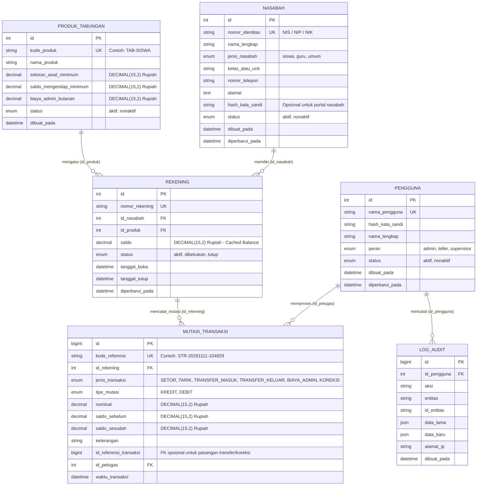

# Skema Database & Desain Ledger (`bankmini_db`)

Seluruh tabel dan kolom wajib menggunakan **Bahasa Indonesia** dengan format `snake_case`, storage engine **InnoDB**, character set `utf8mb4_unicode_ci`, dan satuan mata uang tunggal **Rupiah (`IDR`)** dengan tipe data `DECIMAL(15,2)`.

---

## 1. Entity Relationship Diagram (ERD)

---

## 2. Daftar Tabel & Konvensi Kolom Bahasa Indonesia

| Nama Tabel | Deskripsi | Kolom Kunci & Foreign Key |
| :--- | :--- | :--- |
| `pengguna` | Menyimpan akun petugas internal (Admin, Teller, Supervisor). | PK: `id`, UK: `nama_pengguna` |
| `nasabah` | Menyimpan profil pemilik rekening (Siswa, Guru, Umum). | PK: `id`, UK: `nomor_identitas` |
| `produk_tabungan` | Master parameter produk simpanan dalam Rupiah (`IDR`). | PK: `id`, UK: `kode_produk` |
| `rekening` | Menyimpan rekening tabungan nasabah dan *cached balance* (`saldo`). | PK: `id`, UK: `nomor_rekening`, FK: `id_nasabah`, `id_produk` |
| `mutasi_transaksi` | Buku besar (*Immutable Ledger*) pencatat seluruh mutasi masuk/keluar Rupiah. | PK: `id`, UK: `kode_referensi`, FK: `id_rekening`, `id_petugas`, `id_referensi_transaksi` |
| `log_audit` | Jejak audit aktivitas penting dan perubahan data sensitif. | PK: `id`, FK: `id_pengguna` |

---

## 3. Aturan Invarian Database (Database Invariants)
1. **Invarian Saldo (`rekening.saldo`)**:
   Nilai `rekening.saldo` (dalam Rupiah `DECIMAL(15,2)`) setiap saat harus sama dengan total mutasi `KREDIT` dikurangi total mutasi `DEBIT` pada `mutasi_transaksi` untuk `id_rekening` tersebut, serta sama dengan `saldo_sesudah` pada baris mutasi terakhir.
2. **Immutable `mutasi_transaksi`**:
   Aplikasi tidak memiliki fitur `UPDATE nominal` atau `DELETE` pada tabel `mutasi_transaksi`. Jika terjadi kesalahan pencatatan, sistem membuat baris baru dengan `jenis_transaksi = 'KOREKSI'` yang membalikkan mutasi sebelumnya dan menunjuk ke `id_referensi_transaksi` asal.
3. **Indeks Wajib**:
   - `rekening (nomor_rekening)` — `UNIQUE`
   - `mutasi_transaksi (id_rekening, waktu_transaksi)` — Mempercepat pencarian mutasi rekening per rentang tanggal.
   - `mutasi_transaksi (kode_referensi)` — `UNIQUE`
