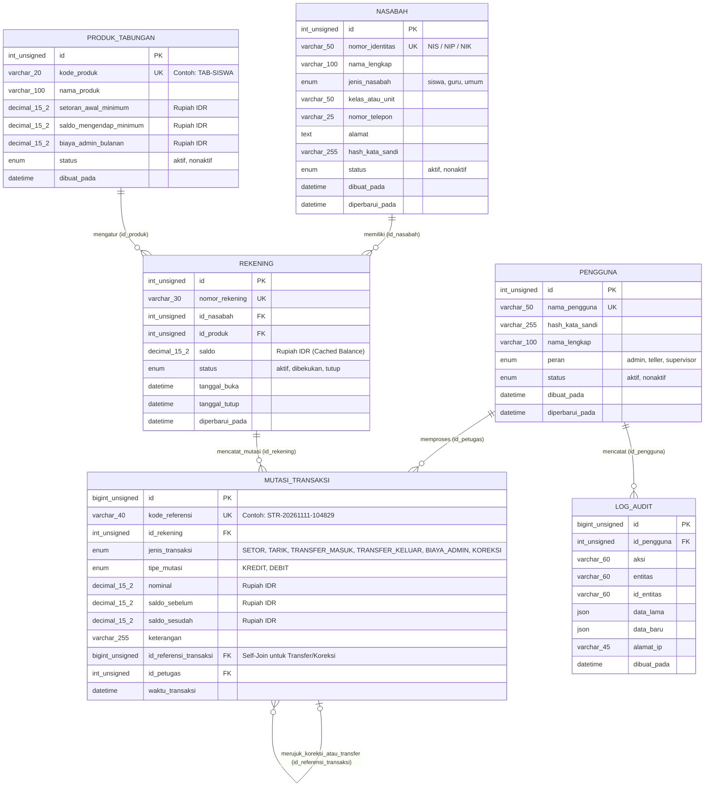

# Arsitektur Database, ERD, Kamus Data, & Normalisasi (`bankmini_db`) — Bahan Belajar RPL

Dokumen ini merupakan referensi utama sekaligus **bahan ajar Rekayasa Perangkat Lunak (RPL)** untuk perancangan basis data relasional pada **Sistem Informasi Bank Mini**. Seluruh tabel dan kolom menggunakan **Bahasa Indonesia** (`snake_case`), mesin penyimpanan **InnoDB**, set karakter `utf8mb4_unicode_ci`, dan mata uang tunggal **Rupiah (`IDR`)** dengan tipe `DECIMAL(15,2)`.

---

## 1. Arsitektur Mesin Penyimpanan MySQL InnoDB & Prinsip ACID (Konsep RPL)

Mengapa aplikasi perbankan **wajib** menggunakan mesin penyimpanan **InnoDB** (bukan MyISAM) di MySQL? Karena InnoDB mendukung **Transaksi ACID** dan **Penguncian Tingkat Baris (*Row-Level Locking*)**:

| Prinsip ACID | Pengertian dalam Rekayasa Perangkat Lunak | Studi Kasus Nyata di Bank Mini |
| :--- | :--- | :--- |
| **A — Atomicity** (*Atomisitas: Semua atau Tidak Sama Sekali*) | Satu rangkaian operasi database dianggap sebagai satu kesatuan utuh. Jika satu langkah gagal, seluruh langkah sebelumnya dibatalkan (`rollBack()`). | Saat transfer Rp 25.000 dari Rekening A ke Rekening B: jika saldo A sudah dikurangi tetapi listrik mati sebelum saldo B bertambah, MySQL otomatis membatalkan pengurangan saldo A. |
| **C — Consistency** (*Konsistensi*) | Database selalu berpindah dari satu kondisi valid ke kondisi valid lainnya sesuai aturan (*constraints* & *invariants*). | Kolom `rekening.saldo` tidak pernah berbeda dengan hasil penjumlahan `KREDIT` dikurangi `DEBIT` pada tabel `mutasi_transaksi`. |
| **I — Isolation** (*Isolasi Konkurensi*) | Transaksi yang berjalan bersamaan tidak boleh saling mengacaukan data. | Dua teller memproses penarikan pada rekening yang sama di detik yang sama: query `SELECT ... FOR UPDATE` memaksa transaksi kedua mengantre hingga transaksi pertama selesai (`commit()`). |
| **D — Durability** (*Daya Tahan Data*) | Setelah transaksi di-`commit()`, perubahan data tercatat permanen di disk meskipun server mengalami *restart* mendadak. | Setelah struk setoran tunai tercetak, dana nasabah dijamin tersimpan permanen di *redo log* InnoDB. |

---

## 2. Entity Relationship Diagram (ERD)

---

## 3. Kamus Data (Data Dictionary) & Spesifikasi Entitas

### 3.1 Entitas `pengguna` (Petugas Internal Bank Mini)
Menyimpan data petugas yang mengoperasikan sistem (Admin, Teller, dan Supervisor).

| Nama Kolom | Tipe Data | Kunci / Constraint | Penjelasan untuk Siswa RPL |
| :--- | :--- | :--- | :--- |
| `id` | `INT UNSIGNED` | `PRIMARY KEY`, `AUTO_INCREMENT` | `UNSIGNED` berarti hanya bilangan bulat positif (`0` s.d. `4,29 miliar`), menggandakan kapasitas ID positif. |
| `nama_pengguna` | `VARCHAR(50)` | `NOT NULL`, `UNIQUE` | Username unik untuk masuk ke sistem. |
| `hash_kata_sandi` | `VARCHAR(255)` | `NOT NULL` | Menyimpan hasil enkripsi satu arah `password_hash()` (BCrypt), **bukan** teks asli kata sandi! |
| `nama_lengkap` | `VARCHAR(100)` | `NOT NULL` | Nama lengkap petugas yang dicetak pada struk/laporan. |
| `peran` | `ENUM('admin','teller','supervisor')` | `NOT NULL` | Menentukan hak akses (*Role-Based Access Control* / RBAC). |
| `status` | `ENUM('aktif','nonaktif')` | `NOT NULL` | Petugas yang berhenti kerja diubah menjadi `nonaktif` (tidak dihapus agar riwayat `id_petugas` di mutasi tetap utuh). |
| `dibuat_pada` | `DATETIME` | `DEFAULT CURRENT_TIMESTAMP` | Waktu pembuatan akun. |
| `diperbarui_pada` | `DATETIME` | `ON UPDATE CURRENT_TIMESTAMP` | Waktu terakhir data akun diperbarui. |

### 3.2 Entitas `nasabah` (Pemilik Rekening)
Menyimpan data profil warga sekolah (Siswa, Guru, atau Umum) yang menabung di Bank Mini.

| Nama Kolom | Tipe Data | Kunci / Constraint | Penjelasan untuk Siswa RPL |
| :--- | :--- | :--- | :--- |
| `id` | `INT UNSIGNED` | `PRIMARY KEY`, `AUTO_INCREMENT` | Identitas unik internal baris nasabah. |
| `nomor_identitas` | `VARCHAR(50)` | `NOT NULL`, `UNIQUE` | Nomor induk resmi seperti NIS (Siswa), NIP (Guru), atau NIK KTP. |
| `nama_lengkap` | `VARCHAR(100)` | `NOT NULL` | Nama lengkap nasabah sesuai identitas. |
| `jenis_nasabah` | `ENUM('siswa','guru','umum')` | `NOT NULL` | Kategori kelompok nasabah. |
| `kelas_atau_unit` | `VARCHAR(50)` | `NOT NULL` | Contoh: `XII RPL 1` atau `Unit Tata Usaha`. |
| `nomor_telepon` | `VARCHAR(25)` | `NULLABLE` | Gunakan `VARCHAR` (bukan `INT`) untuk nomor telepon agar angka `0` di depan (`0812...`) atau kode `+62` tidak hilang! |
| `alamat` | `TEXT` | `NULLABLE` | Alamat tempat tinggal nasabah. |
| `status` | `ENUM('aktif','nonaktif')` | `NOT NULL` | Status keaktifan nasabah. |

### 3.3 Entitas `produk_tabungan` (Master Produk Simpanan Rupiah IDR)
Menyimpan aturan bisnis untuk setiap jenis produk tabungan.

| Nama Kolom | Tipe Data | Kunci / Constraint | Penjelasan untuk Siswa RPL |
| :--- | :--- | :--- | :--- |
| `id` | `INT UNSIGNED` | `PRIMARY KEY`, `AUTO_INCREMENT` | ID unik produk. |
| `kode_produk` | `VARCHAR(20)` | `NOT NULL`, `UNIQUE` | Kode singkat produk (`TAB-SISWA`, `TAB-GURU`, `TAB-UMUM`). |
| `nama_produk` | `VARCHAR(100)` | `NOT NULL` | Nama produk tabungan. |
| `setoran_awal_minimum` | `DECIMAL(15,2)` | `NOT NULL` | Batas minimal setoran pertama saat membuka rekening (Rupiah IDR). |
| `saldo_mengendap_minimum` | `DECIMAL(15,2)` | `NOT NULL` | Saldo minimal yang **tidak boleh ditarik** agar rekening tetap aktif. |
| `biaya_admin_bulanan` | `DECIMAL(15,2)` | `NOT NULL` | Potongan administrasi bulanan dalam Rupiah IDR. |

### 3.4 Entitas `rekening` (Rekening Tabungan Nasabah)
Menghubungkan satu `nasabah` dengan satu `produk_tabungan` serta menyimpan saldo terkini.

| Nama Kolom | Tipe Data | Kunci / Constraint | Penjelasan untuk Siswa RPL |
| :--- | :--- | :--- | :--- |
| `id` | `INT UNSIGNED` | `PRIMARY KEY`, `AUTO_INCREMENT` | ID internal rekening. |
| `nomor_rekening` | `VARCHAR(30)` | `NOT NULL`, `UNIQUE` | Nomor rekening resmi nasabah (contoh: `BM-202611-01-482910`). |
| `id_nasabah` | `INT UNSIGNED` | `FOREIGN KEY -> nasabah(id)` | Satu nasabah dapat memiliki satu atau lebih rekening (`1:N`). |
| `id_produk` | `INT UNSIGNED` | `FOREIGN KEY -> produk_tabungan(id)` | Mengacu ke aturan produk tabungan yang dipilih. |
| `saldo` | `DECIMAL(15,2)` | `NOT NULL DEFAULT 0.00` | *Cached Balance* dalam Rupiah (`IDR`) yang dikunci dengan `FOR UPDATE` saat transaksi. |
| `status` | `ENUM('aktif','dibekukan','tutup')` | `NOT NULL` | Hanya rekening berstatus `aktif` yang boleh melakukan transaksi. |

### 3.5 Entitas `mutasi_transaksi` (Buku Besar / Immutable Ledger)
Tabel paling krusial yang mencatat setiap aliran uang masuk (`KREDIT`) dan keluar (`DEBIT`).

| Nama Kolom | Tipe Data | Kunci / Constraint | Penjelasan untuk Siswa RPL |
| :--- | :--- | :--- | :--- |
| `id` | `BIGINT UNSIGNED` | `PRIMARY KEY`, `AUTO_INCREMENT` | Menggunakan `BIGINT` (8 byte) karena jumlah transaksi terus bertambah jutaan baris sepanjang umur aplikasi. |
| `kode_referensi` | `VARCHAR(40)` | `NOT NULL`, `UNIQUE` | Nomor bukti transaksi unik pada struk (contoh: `STR-20261111-104829`). |
| `id_rekening` | `INT UNSIGNED` | `FOREIGN KEY -> rekening(id)` | Rekening yang mengalami perubahan saldo. |
| `jenis_transaksi` | `ENUM(...)` | `NOT NULL` | `SETOR`, `TARIK`, `TRANSFER_MASUK`, `TRANSFER_KELUAR`, `BIAYA_ADMIN`, `KOREKSI`. |
| `tipe_mutasi` | `ENUM('KREDIT','DEBIT')` | `NOT NULL` | Dalam akuntansi tabungan bank: `KREDIT` = menambah saldo tabungan nasabah; `DEBIT` = mengurangi saldo tabungan nasabah. |
| `nominal` | `DECIMAL(15,2)` | `NOT NULL` | Nilai nominal transaksi dalam Rupiah (`IDR`). |
| `saldo_sebelum` | `DECIMAL(15,2)` | `NOT NULL` | Rekaman saldo rekening tepat sebelum transaksi ini dieksekusi. |
| `saldo_sesudah` | `DECIMAL(15,2)` | `NOT NULL` | Rekaman saldo rekening tepat sesudah transaksi ini dieksekusi. |
| `id_referensi_transaksi` | `BIGINT UNSIGNED` | `FOREIGN KEY -> mutasi_transaksi(id)` | *Self-Referencing Foreign Key*: menghubungkan mutasi `TRANSFER_MASUK` ke `TRANSFER_KELUAR`, atau menghubungkan `KOREKSI` ke transaksi asal yang dikoreksi! |
| `id_petugas` | `INT UNSIGNED` | `FOREIGN KEY -> pengguna(id)` | Petugas/teller yang bertanggung jawab memproses transaksi. |

### 3.6 Entitas `log_audit` (Jejak Audit Keamanan)
Menyimpan rekaman sebelum (`data_lama`) dan sesudah (`data_baru`) dalam format `JSON` beserta alamat IP pelaku untuk keperluan investigasi/audit.

---

## 4. Normalisasi Database (1NF s.d. 3NF) & Denormalisasi Terkendali (Materi RPL)

Skema `bankmini_db` telah memenuhi kaidah **Bentuk Normal Ketiga (*Third Normal Form* / 3NF)**:
1. **1NF (*First Normal Form*)**: Setiap kolom bernilai atomik (tunggal, tidak ada satu kolom yang menyimpan banyak nomor rekening dipisahkan koma).
2. **2NF (*Second Normal Form*)**: Seluruh atribut non-kunci bergantung penuh pada Primary Key masing-masing tabel (`nama_produk` dan `saldo_mengendap_minimum` dipisahkan ke tabel `produk_tabungan`, tidak ditulis berulang di tabel `rekening`).
3. **3NF (*Third Normal Form*)**: Tidak ada ketergantungan transitif (`nama_lengkap` dan `kelas_atau_unit` nasabah disimpan di tabel `nasabah`, sedangkan tabel `rekening` hanya menyimpan `id_nasabah`).

### Mengapa Ada Kolom `rekening.saldo`? (*Controlled Denormalization / Cached Balance*)
Secara teori murni, saldo rekening bisa dihitung kapan saja dengan menjumlahkan seluruh `KREDIT` dikurangi `DEBIT` di tabel `mutasi_transaksi`. Namun, jika sebuah rekening sudah memiliki 50.000 baris transaksi, melakukan `SUM()` setiap kali cek saldo akan memperlambat database.
Oleh karena itu, dalam rekayasa sistem perbankan digunakan teknik **Cached Balance (`rekening.saldo`)** yang dijaga konsistensinya 100% melalui **Database Transaction ACID** di dalam `LayananTransaksi`:
$$\text{Saldo Sesudah} = \text{Saldo Sebelum} \pm \text{Nominal Transaksi}$$
Kolom `rekening.saldo` **wajib selalu diperbarui dalam satu transaksi `beginTransaction()` yang sama** dengan perintah `INSERT INTO mutasi_transaksi`.
