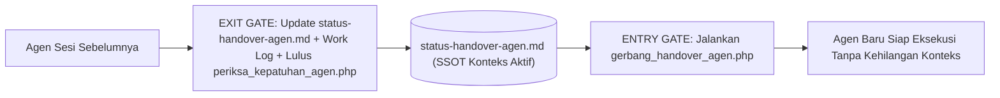

# Protokol Gate Agen Baru & Handover Lintas Sesi (Wajib untuk AI Agent)

Dokumen ini menetapkan mekanisme **Entry Gate (Gerbang Masuk Agen Baru)** dan **Exit/Handover Gate (Gerbang Serah Terima Agen)** agar pergantian sesi atau pergantian agen AI tidak pernah kehilangan konteks arsitektur, progres kode, maupun tugas yang sedang berjalan.

---

## 1. Masalah yang Dicegah oleh Gate Handover
Tanpa *Handover Gate* yang terstruktur, agen baru yang masuk ke sesi baru berisiko:
- Menebak-nebak file mana yang sudah selesai dan mana yang baru berupa kerangka (*stub*).
- Mengubah ulang konvensi atau keputusan arsitektur yang sudah disepakati di ADR.
- Melupakan tugas lanjutan (*next steps*) atau *edge case* dari sesi sebelumnya.

---

## 2. Alur Dua Gerbang (Dual-Gate Handover Architecture)



### A. ENTRY GATE (Wajib Saat Agen Baru Memulai Sesi)
Setiap kali agen baru memulai percakapan atau menerima tugas baru, agen **wajib** menjalankan atau membaca ringkasan dari:
```powershell
C:\xampp\php\php.exe C:\xampp\htdocs\www\bankmini\dokumentasi\06-aturan-agen\skrip\gerbang_handover_agen.php
```
Skrip *Entry Gate* ini akan:
1. Menampilkan **Status Fase Projek Saat Ini**, **Work Log Terakhir**, **Komponen yang Sudah Selesai**, dan **Antrean Tugas Prioritas Berikutnya** dari [`status-handover-agen.md`](./status-handover-agen.md).
2. Memverifikasi kesiapan **Prasyarat Lingkungan** (PHP `>= 8.2`, ekstensi `pdo_mysql`, `bcmath`, `mbstring`, `openssl`, `tokenizer`, Composer `vendor/`, serta Node.js/`node_modules/` Playwright) sebagaimana tercantum pada [`arsitektur-sistem.md`](../02-panduan-dev/arsitektur-sistem.md).
3. Memverifikasi bahwa kondisi awal *workspace* (`bankmini` beserta `dokumentasi/`) berada dalam keadaan sehat (`0 Pelanggaran`).

### B. EXIT / HANDOVER GATE (Wajib Sebelum Agen Mengakhiri Tugas)
Sebelum agen menutup tugas dan menyerahkan hasil ke pengguna (atau ke agen berikutnya), agen **wajib**:
1. Memperbarui [`status-handover-agen.md`](./status-handover-agen.md) dengan:
   - Daftar komponen/fitur yang baru diselesaikan pada sesi tersebut.
   - Status pengujian QA terakhir (`periksa_kepatuhan_agen.php`, `phpcs`, `phpstan`, `jalankan_semua_tes.php`, dan `npm run test:e2e`).
   - Daftar tugas prioritas selanjutnya (*Next Actionable Tasks*) secara spesifik beserta jalur filenya.
   - Catatan teknis/konteks penting yang tidak boleh dilanggar agen berikutnya.
2. Mencatat detail pengerjaan di `04-work-log/` dan mendaftarkannya di `04-work-log/README.md`.
3. Menjalankan `periksa_kepatuhan_agen.php`, `periksa-konsistensi.ps1` (termasuk `PHPCS` 0 Error/0 Warning & `PHPStan Level 8`), serta `npm run test:e2e` (0 Console Error/Warning) hingga **LULUS 100%**.
4. **Blokir Commit & Push (`Zero Bug/Error/Warning`)**: Agen **dilarang keras** mengeksekusi `git commit` ataupun `git push` bila belum seluruh QA lulus bersih (diproteksi juga oleh `.githooks/pre-commit`, `.githooks/pre-push`, serta skrip [`gerbang_komit_dan_push.ps1`](./skrip/gerbang_komit_dan_push.ps1)).

